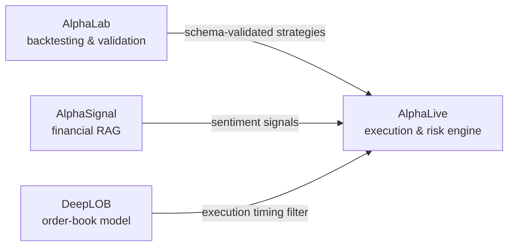

# Hi, I'm Bernardo 👋

**First-Class Computer Science graduate** · **MSc Data Science & Machine Learning @ UCL** · **London, UK**

I build reliable Python systems across machine learning, financial technology, and applied AI. My work spans backend services, retrieval systems, transformer experimentation, full-stack products, and extensively tested software.

## Trading research stack

Four projects that work together, from research to execution:

| Project | Description |
|---|---|
| [**AlphaLab**](https://github.com/bernardoguterres/AlphaLab) | Backtesting and validation platform with runtime-verified next-bar execution, realistic transaction costs, train-only walk-forward selection, and schema-validated strategy export to AlphaLive. |
| [**AlphaLive**](https://github.com/bernardoguterres/AlphaLive) | Restart-safe execution and risk engine for AlphaLab strategies, featuring idempotent orders, circuit breakers and [zero decision-bar mismatches on seven daily/intraday strategy fixtures using SPY/MSFT data](https://github.com/bernardoguterres/AlphaLive#alphalab-compatibility-and-measured-parity) (bounded test evidence; not yet live-validated). |
| [**AlphaSignal**](https://github.com/bernardoguterres/AlphaSignal) | Financial RAG service combining hybrid BM25 and dense retrieval, cross-encoder reranking, citation-verified generation and sentiment signals consumed by AlphaLive (retrieval quality not yet benchmarked). |
| [**DeepLOB**](https://github.com/bernardoguterres/DeepLOB) | PyTorch CNN + Inception + LSTM reimplementation of DeepLOB (Zhang et al., 2019), trained on FI-2010 (macro F1 0.78 at k=5), with Integrated Gradients and SHAP explainability and a FastAPI inference server used by AlphaLive. |

## Other projects

| Project | Description |
|---|---|
| [**Jarvis**](https://github.com/bernardoguterres/Jarvis) | Local-first personal intelligence system for macOS with persistent memory, research and decision workflows, guarded integrations, and a FastAPI/SQLite plus React/TypeScript architecture. |
| [**RunnasUp**](https://github.com/bernardoguterres/RunnasUp) | Local-first running analytics built with React, TypeScript and Python: import Strava histories, track an explainable personal performance rating, and explore experimental scoring methods. |
| [**xai-dr-finance**](https://github.com/bernardoguterres/xai-dr-finance) | Python framework combining six dimensionality-reduction methods with five explainability techniques to generate auditable IF–THEN rules and test reliability across four noise regimes. |
| [**nbaMVPPredictor**](https://github.com/bernardoguterres/nbaMVPPredictor) | ML ranking system forecasting NBA MVP vote shares across 34 seasons, with a time-aware rolling backtest, 52 engineered features, SHAP explainability and Ridge / Random Forest / XGBoost compared on ranking metrics. |

## Core stack

---

📍 London, UK · [LinkedIn](https://linkedin.com/in/bernardoguterres) · [Email](mailto:bernardomloguterres@gmail.com)
