<a href="https://bernardoguterres.vercel.app/"><picture><source media="(prefers-color-scheme: dark)" srcset="cards/hero-dark.svg"></picture></a>

**Bernardo Guterres** · MSc Data Science & Machine Learning at UCL · London, UK\
I build ML systems, local-first AI, and tools for trading research.

<a href="https://bernardoguterres.vercel.app/"><picture><source media="(prefers-color-scheme: dark)" srcset="cards/tile-portfolio-dark.svg"></picture></a> <a href="https://github.com/bernardoguterres?tab=repositories"><picture><source media="(prefers-color-scheme: dark)" srcset="cards/tile-repositories-dark.svg"></picture></a> <a href="https://www.linkedin.com/in/bernardoguterres/"><picture><source media="(prefers-color-scheme: dark)" srcset="cards/tile-linkedin-dark.svg"></picture></a>

[Portfolio](https://bernardoguterres.vercel.app/) · [Repositories](https://github.com/bernardoguterres?tab=repositories) · [LinkedIn](https://www.linkedin.com/in/bernardoguterres/) · [Email](mailto:bernardomloguterres@gmail.com)

## Featured projects

<a href="https://github.com/bernardoguterres/AlphaLive#alphalab-compatibility-and-measured-parity"><picture><source media="(prefers-color-scheme: dark)" srcset="cards/alpha-system-dark.svg"></picture></a>

**Alpha System**, a research-to-execution trading stack. Strategies are backtested in AlphaLab, exported by hand, and run by AlphaLive under its own risk controls.

- [**AlphaLab**](https://github.com/bernardoguterres/AlphaLab): backtesting and validation with next-bar execution, transaction costs and train-only walk-forward selection. It exports a schema-validated strategy JSON, which a person moves into AlphaLive manually.
- [**AlphaLive**](https://github.com/bernardoguterres/AlphaLive): restart-safe execution and risk engine with idempotent orders and circuit breakers. It re-implements the strategy signals independently.
- [**AlphaSignal**](https://github.com/bernardoguterres/AlphaSignal): financial RAG service with hybrid BM25 and dense retrieval, cross-encoder reranking and citation-verified generation. In AlphaLive it is an optional, fail-open sentiment gate on entries only: a BUY is blocked only when an evaluated score falls below the threshold.

**Parity:** a CI-enforced test shows [zero decision-bar mismatches against AlphaLab-generated fixtures](https://github.com/bernardoguterres/AlphaLive#alphalab-compatibility-and-measured-parity) across seven strategies on historical SPY/MSFT data. This is bounded test evidence, not live-trading validation.

<a href="https://github.com/bernardoguterres/Jarvis"><picture><source media="(prefers-color-scheme: dark)" srcset="cards/jarvis-dark.svg"></picture></a> <a href="https://github.com/bernardoguterres/RunnasUp"><picture><source media="(prefers-color-scheme: dark)" srcset="cards/runnasup-dark.svg"></picture></a>

- [**Jarvis**](https://github.com/bernardoguterres/Jarvis): local-first personal assistant for macOS with persistent memory. It asks for confirmation before any external action.
- [**RunnasUp**](https://github.com/bernardoguterres/RunnasUp): running analytics with an explainable personal performance rating. A working prototype, checked on synthetic data only.

## More work

- [**SolvedIn**](https://github.com/bernardoguterres/SolvedIn): offline C++20 solvers for LinkedIn-style puzzles. Queens, Mini Sudoku, Tango, Zip and Patches each solved 100/100 archived real boards. Wend needs a supplied dictionary. Crossclimb only orders answer words you supply and Pinpoint only ranks lexicon categories, so neither solves unseen clues. Unofficial and not affiliated with LinkedIn.
- [**DeepLOB**](https://github.com/bernardoguterres/DeepLOB): PyTorch reimplementation of DeepLOB (Zhang et al., 2019) trained on FI-2010, with Integrated Gradients and SHAP explainability and a FastAPI inference server.
- [**xai-dr-finance**](https://github.com/bernardoguterres/xai-dr-finance): explainable AI for financial models, combining dimensionality reduction with explainability methods to produce auditable IF–THEN rules.
- [**nbaMVPPredictor**](https://github.com/bernardoguterres/nbaMVPPredictor): ML ranking system forecasting NBA MVP vote shares, with a time-aware rolling backtest and SHAP explainability.

## Selected highlights

- **Encode Club London Hackathon — Google DeepMind track winner.** Co-built Andes, an AI assistant that proposes recovery plans for a simulated electricity grid using Chilean demand and generation data.
- **G-Research London Quant Challenge — Round 3 winner.** Our team built a strategy that adapted its decisions as new information arrived and accounted for competition from other teams.

**Core stack:** Python · PyTorch · scikit-learn · FastAPI · Flask · SQL · TypeScript · React · Docker · C++

---

📍 London, UK · [Portfolio](https://bernardoguterres.vercel.app/) · [LinkedIn](https://www.linkedin.com/in/bernardoguterres/) · [Email](mailto:bernardomloguterres@gmail.com)

Cards are generated by [`scripts/render_readme_cards.py`](scripts/render_readme_cards.py) from a snapshot in [`data/contributions.json`](data/contributions.json); run [`scripts/fetch_contributions.py`](scripts/fetch_contributions.py) and the renderer to refresh them. Fonts: Newsreader, Source Sans 3 and IBM Plex Mono, embedded as subsets under the [SIL Open Font License](fonts/).
